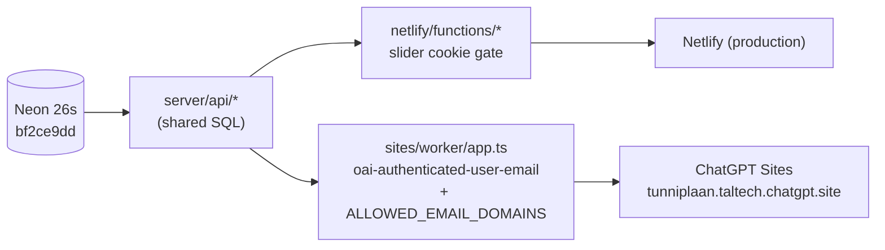

# Handoff — Live-data verification and ChatGPT Sites dual target

**Date:** 2026-10-20
**Repo:** `C:\Projects\tunniplaan` (branch `dev`, `00ca431`, equal to `origin/dev`)
**Companion repo:** `C:\Projects\tunniplaanScraping`. See its
`docs/261020-handoff-26s-refresh-scrape-ingest.md` for the scrape and ingest that produced
the dataset verified here.
**Open PR:** [#2](https://github.com/siyi-ma/tunniplaan/pull/2) `cursor/feat-chatgpt-sites-aa65` → `dev`
(head `a5c2aa8`, +2023/−409, 30 files, mergeable, not merged, not deployed).

---

## 1. Current Task Objectives

| | Objective | State |
|---|---|---|
| ✓ | Verify the 2026-10-20 Neon dataset against TalTech's official API | Done. 20 random groups (seed `106213173`): 3018/3018 sessions (100 %), 0 missing, 0 extra |
| ✓ | Re-check the groups the 2026-09-04 headless run corrupted | Done. VDXR11, VDXR31, VDXR32, VDXR51, VDXR52, VDXR71: 977/977 |
| ✓ | Evaluate moving to ChatGPT Sites (`tunniplaan.taltech.chatgpt.site`) | Done. Decision: dual target, Netlify stays production |
| ✓ | Implement the Sites target | Done as PR #2 by a Cursor cloud agent; 154 tests pass |
| x | Review and merge PR #2 into `dev` | Siyi |
| x | Create the Site, set env, link project, release and deploy | Siyi, after merge |
| x | Promote `00ca431` (verification script) to `main` | Not done. `dev` is 1 commit ahead (`c89c21a..00ca431`) |

---

## 2. Current Progress

### Completed this session

**Verification (no repo change).** `node scripts/sample-verify-vs-official.js --groups 20`
on `dev` against live Neon and TalTech's public REST API. Run 2026-10-20 13:02 (Europe/Tallinn).
Report: `%TEMP%\tunniplaan_verify_20261020.md` (outside the repo). Dataset under test:
`dataset_version bf2ce9dd…`, 26s, 1019 courses, 428 groups, 67071 sessions, scraped
20.10.2026 12:20.

**Decision.** Students sign in with Uni-ID, which the TalTech ChatGPT workspace provides, so
Sites can admit by identity instead of the slider. Netlify is kept as production; Sites is a
second target reading the same Neon.

**PR #2 (not on `dev`).** Contents as stated in the PR body:

| Area | Files | Change |
|---|---|---|
| Shared SQL | `server/api/{manifest,courses,timetable,cache}.js` | Dataset queries live once |
| Netlify | `netlify/functions/get{DatasetManifest,Courses,Timetable}.js` | Thin adapters; Neon from `process.env`; slider gate kept |
| Sites Worker | `sites/worker/{app,index}.ts` | `/api/getDatasetManifest`, `/api/getCourses`, `/api/getTimetable`; `ASSETS` for static |
| Admission | `sites/worker/app.ts` | 401 `unauthenticated` without `oai-authenticated-user-email`; 403 `forbidden_domain` outside `ALLOWED_EMAIL_DOMAINS` (default `taltech.ee`, `*` = any) |
| Caching | `server/api/cache.js` | Gated responses rewritten to `private` |
| Front end | `index.html`, `main.js`, `course-data.js` | Slider hidden on the Sites target |
| Build | `scripts/build-sites.mjs`, `scripts/bundle-worker.mjs`, `scripts/sites-release.mjs`, `scripts/lib/sites-guards.mjs`, `package.json` | `npm run build:sites`; `npm run sites:release -- --dest <folder>` refuses a dirty tree and blocks dataset dumps |
| Config | `.openai/hosting.json` (`project_id: null`), `.env.example`, `.gitignore` (`dist/`) | |
| Docs | `docs/chatgpt-sites.md`, `CLAUDE.md`, `README.md`, `docs/README.md`, `docs/distilled-how-to-run.md` | Runbook and dual-target notes |
| Tests | `tests/sites/*.test.js`, `tests/frontend/course-data.test.js` | 154 passing |

### Known working

- Netlify production and `dev` preview, unchanged.
- Live Neon dataset `bf2ce9dd…` matches upstream on every sampled session.

---

## 3. Key Context

| Item | Value |
|---|---|
| Front end | Vanilla JS, Tailwind CDN |
| Netlify | `main` = production, `dev` = `https://dev--taltech-tunniplaan.netlify.app` |
| Sites | `tunniplaan.taltech.chatgpt.site`, workspace-only (Uni-ID), manual release |
| DB | Neon; webapp uses read-only `webapp_ro`; scraper uses `scraper_rw` |
| Repo visibility | **public** on GitHub |



### Gotchas

- **The PR is not proven on a real Site** (its own "Not proven" list): `ASSETS` mounting,
  platform header injection, `private` cache on the Sites CDN, `@neondatabase/serverless`
  inside the Sites isolate with a real `webapp_ro` URL.
- **Docs edits on `dev` now will conflict with PR #2**, which rewrites `CLAUDE.md`,
  `README.md`, `docs/README.md`, `docs/distilled-how-to-run.md`.
- `siyi-ma/sar-reader` was unreadable to the cloud agent (GitHub 404), so the allow-list
  default was written from the task, not copied from that repo.

---

## 4. Key Findings

1. **The dataset is correct end to end.** 3018/3018 random-sample sessions and 977/977 VDXR
   sessions; the contract tests alone could not show this because they compare the scrape
   with itself.
2. **A dual target keeps a rollback.** Netlify continues to serve production while the Site is
   proven; rolling the Site back is deploying a previous saved version in the Sites UI and does
   not touch Netlify or Neon.
3. **`CLAUDE.md:7` says ~395 groups;** the current dataset has 428 (+1 doctoral). Low priority;
   fold into the PR #2 merge or a later docs pass.

---

## 5. Incomplete Items (priority-ordered)

1. **Review and merge PR #2 into `dev`** (Siyi). Check the "Not proven on a real Site" list.
2. **Create the Site** (Siyi): slug `tunniplaan`, workspace-only sharing.
3. **Set `NEON_DATABASE_URL`** in the Site settings to the read-only `webapp_ro` string. **Never
   `scraper_rw`.** Optional `ALLOWED_EMAIL_DOMAINS=taltech.ee`, `CALENDAR_SESSION_LIMIT`.
   Do not copy `HUMAN_VERIFICATION_SECRET`.
4. **Put the assigned `project_id` in `.openai/hosting.json`** (no secrets in that file), commit on `dev`.
5. **Release and deploy:** from a clean checkout, `npm ci && npm test && npm run sites:release -- --dest <folder>`,
   then save a version and deploy it in the Sites UI.
6. **Promote `dev` to `main`** when Siyi chooses. Currently `c89c21a..00ca431`. Pushing `main` is a
   Netlify production deploy.

---

## 6. Suggested Handoff Path

**Read:** PR #2 body and `docs/chatgpt-sites.md` on the PR branch; `CLAUDE.md` § 2b (human gate);
`%TEMP%\tunniplaan_verify_20261020.md`.

**Verify (after PR #2 is merged):**

```bash
cd /c/Projects/tunniplaan
git checkout dev && git pull
npm test                     # expect 154 passing
npm run build:sites          # dist/ must contain no unified_courses.json or sessions.json
node scripts/sample-verify-vs-official.js --groups 20
```

**Recommended next action:** Siyi reviews PR #2.

---

## 7. Risks and Notes

- **Never add `unified_courses.json`, `sessions.json` or any dataset dump to this repo or to `dist/`.**
  The repo is public; a dump is an ungated public copy of the dataset.
- **Wrong Neon role on the Site** (`scraper_rw`) would expose a write-capable credential to a
  hosted runtime. Use `webapp_ro` only.
- **`.openai/hosting.json` must never hold a secret.** It is committed.
- **Pushing `dev` triggers a Netlify preview deploy;** pushing `main` deploys production.
- **`test.txt`** ("Test deploy", 2025-08-18) is tracked in the repo root. Harmless, but noise.

---

## 8. Suggested First Step for the Next Agent

```bash
cd /c/Projects/tunniplaan
git fetch origin && git log --oneline origin/dev -3
gh pr view 2 --repo siyi-ma/tunniplaan    # merged yet? if not, stop: Siyi owns the review
```
